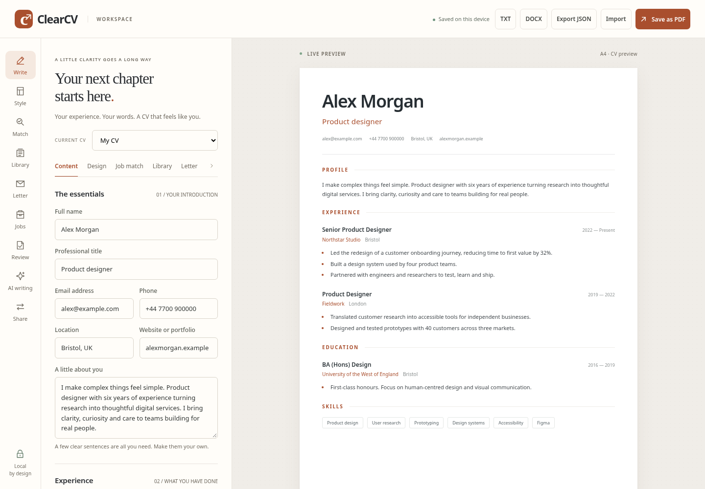

# ClearCV



[Try the live demo](https://tylerbuilds.github.io/clearcv/) · [Linux/macOS checks](https://github.com/tylerbuilds/clearcv/actions/workflows/verify.yml)

A calm, local-first CV workspace. Write your story, choose an original layout, build application-specific CVs and letters, track your search and export editable documents — without an account or subscription. Optional AI writing uses an explicitly configured model service.

ClearCV is an independently written open-source implementation of publicly observable CV-building behaviours. It is not affiliated with Enhancv and does not contain its code, branding, templates or private data. The functional expansion covers local free and premium workflow families. The source-linked parity ledger records remaining and unknown capabilities; complete commercial parity is not claimed.

## Run on Linux or macOS

Install Node.js **22.19 or newer** (Node 24.11+ is also supported), then run:

```sh
git clone https://github.com/tylerbuilds/clearcv.git
cd clearcv
npm ci
npm start
```

Open **http://localhost:4201** in a recent browser. The development server binds to localhost by default. The pinned PDF.js dependency supplies local PDF text extraction; build/start prepare its browser assets without a CDN.

```sh
npm test            # Model and import validation checks
npm run build       # Produces the static site in dist/
npm run preview     # Serves the production build on port 4201
```

This is a browser application for Linux and macOS, not a native desktop package. Windows should work with the same commands but is not part of the initial qualification target.

## What works

- Named CV library: create, duplicate, rename, switch and delete independent documents.
- A complete master CV for reusable career history; named snapshots with recovery when restoring.
- Editable profile, experience, education, skills and custom sections, with live preview and accessible ordering.
- Section headings, visibility and order; three original templates, accent colours, fonts, size, spacing, margins, A4/Letter paper and optional locally resized portraits.
- Cover letters stored with each CV, editable preview and PDF/TXT/DOCX exports. A clearly labelled rule-based draft reuses supplied facts.
- Manual job tracking with stages, notes, application/follow-up dates and linked CVs/letters. Links point to editable documents: duplicate or snapshot a CV at submission to retain its exact content.
- Automatic browser-local saves; current-CV JSON export and whole-workspace backups. Importing adds or merges documents, preserving the existing library.
- TXT and bounded PDF/DOCX text extraction into an editable review area before creating a new CV. Formatting, photos and semantic field mapping are not imported; scanned-page OCR is unavailable. Encrypted PDFs can be unlocked locally with a password that is not stored.
- Browser PDF printing, plain text and editable DOCX exports.
- A transparent writing checklist and job-description keyword comparison. Reviewed ordering suggestions create a tailored copy using existing facts. **These rules are not AI, an ATS score or a hiring prediction.**
- Optional real AI headline, objective, summary, bullet, cover-letter and selected-field translation candidates through a configured local server. Source/context are visible before Generate; candidates must be reviewed before Apply and support field-level Undo. Summary tailoring creates an independent CV copy. AI is unavailable on the static demo. Interview questions and practice-answer feedback produce reviewed in-tab notes with TXT export.

To export a PDF, choose **Save as PDF**, select the browser’s PDF destination, use the selected A4 or Letter paper size and disable browser headers and footers. Check the preview before saving; pagination varies between browsers. Valid supplied email and HTTP(S) website values become clickable links; other contact values remain text.

- Optional self-hosted sharing for the active CV: separate owner/edit/view links, explicit save and refresh, revision-conflict protection, comments, history and permission revocation. Cloud refresh keeps a named local recovery snapshot; unrelated local CVs and job records are never shared.

## Your data

The library, job descriptions, photos, letters and applications stay in this browser's `localStorage`. There are no analytics, telemetry or required accounts. Optional sharing sends the full editable active CV, including hidden sections, its cover letter and pasted job description, to the configured same-origin self-hosted service when you create/save a shared document. Links use bearer tokens in URL fragments; anyone holding a link can use its permission. Tokens remain in the open tab/fragment and are excluded from workspace backups. Keep the owner link privately to regain access; server files also contain private document data.

Optional AI sends only the selected source text and context when you click Generate; the operator supplies the provider configuration outside the browser and repository. A configured provider has its own data handling. The static demo makes no model calls.

Anyone with access to the same browser profile may be able to read your library. Private browsing, restricted storage and quota limits can prevent saves; the app reports this and keeps edits open for export.

A workspace JSON backup includes **every CV, snapshot, letter, image, job description, master CV and application record**. Keep it somewhere you trust. Document JSON is limited to 1 MB and workspace JSON to 4 MB. Unknown fields, invalid layouts, duplicate IDs and malformed values are rejected before changing the library. Workspace imports merge with new IDs and preserve the current master.

Original release version 1 CV exports are migrated with additive defaults. The original `clearcv.document.v1` browser value is retained when the new `clearcv.workspace.v1` library is created. If a saved workspace cannot be read, its raw bytes are copied to a recovery key before replacement. If that copy cannot save, ordinary autosaves are locked: Library offers original recovery download and an explicit replacement action. No ordinary edit discards an unbacked original.

Practical local bounds are 25 CVs, 10 named snapshots per CV, 20 custom sections, 60 items per basic section and 150 application records. These keep browser storage bounded; they are not subscription tiers. Snapshots contain complete CV and cover-letter state. AI Undo lasts while the page remains open; save a named snapshot for persistent history.

## Research and scope

[Free and premium parity ledger](docs/research/parity-ledger.md), [all-tier source comparison](docs/research/feature-comparison.md) and [feature map](docs/research/feature-map.md) distinguish source observations, implementation decisions and gaps. [REA provenance](docs/research/rea-provenance.md) records the pinned reverse-engineering tool used for public discovery. Sanitised proof metadata and [verification](docs/verification.md) document the actual checks.

Remaining limits include LinkedIn extraction, semantic ATS validation, full-document AI translation, the full target template/section catalogue, automatic multi-user merging and full-workspace cloud synchronisation, job-provider feeds and alerts, a browser extension, company research and voice interview services, team branding and native installers. Custom statuses/columns, tracker spreadsheet import and automatic reminders are not shipped. DOCX export contains editable text and layout settings, but does not embed the portrait.

See the ledger for each official source, known tier and delivered/remaining/unknown boundary. Optional AI depends on a configured provider; rules remain available without it. No generated claim is automatically accepted as true.

## Contribute

The editor uses standard browser modules. Its pinned PDF.js dependency is served locally for extraction; no other document content is uploaded by import. Keep pure document and workspace operations in `src/model.js` and `src/workspace.js` and user interface code in `src/app.js`. Render user content as text, validate imported data before storing it, and retain local-first defaults and the explicit, reviewed optional AI boundary. Use British English and original layouts, copy and assets.

Run `npm test` and `npm run build` before submitting a pull request. See [AGENTS.md](AGENTS.md) for repository-specific constraints.

MIT licensed. See [LICENSE](LICENSE).

## Browser verification

To run development browser checks, install the pinned dependencies and Chromium:

```sh
npm ci
npx playwright install chromium
npm run build
npm run test:browser
```

Linux runners may need `npx playwright install --with-deps chromium` for browser system libraries. `BROWSER_EXECUTABLE=/path/to/chrome npm run test:browser` uses an existing browser. The GitHub workflow runs model tests, a static build and real browser edit/persistence/export checks on both Ubuntu and macOS, then publishes the static demo only after both pass.

[REA investigation provenance](docs/research/rea-provenance.md) records public observations, receipt digests and explicit research limits.
