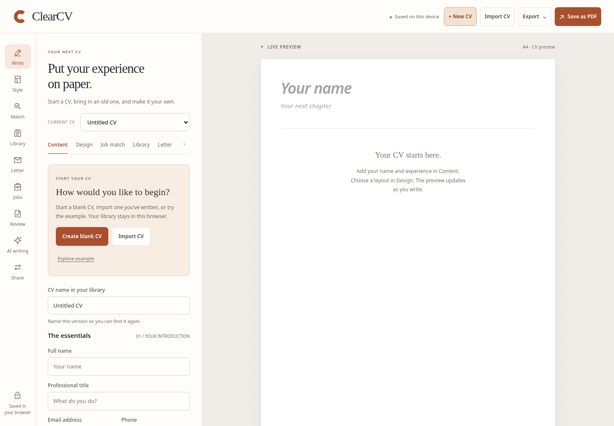

# ClearCV


Write your CV, keep versions for different jobs and export them as PDF or editable Word documents. ClearCV is free and open source. It runs in your browser, with no account or subscription. Your CVs save on your device.

[Try ClearCV](https://tylerbuilds.github.io/clearcv/) · [MIT licence](LICENSE) · [Brand kit](docs/brand.md) · [Linux and macOS checks](https://github.com/tylerbuilds/clearcv/actions/workflows/verify.yml)



[On a phone](docs/screenshots/blank-start-mobile-0.5.2.png)

## Start your CV

Choose **Create blank CV**, **Import CV** or **Explore example**. Give your CV a name in **Content**, then add your contact details, experience, education and skills. Open **Design** to choose a layout, font, colour and page size. On a phone, use **Edit** and **Preview** to switch between the form and the paper.

**New CV** adds another blank CV. You can also create one from **Library**. **Explore example** adds a separate example to edit; **New from master** copies your saved career history. Your existing CVs and job records stay in the library.

Choose **Save as PDF**, or open **Export** for TXT, DOCX and JSON. Download a **Workspace backup** to keep a copy of your whole library. The [first-CV guide](docs/first-cv.md) explains saving and backups.

## What you can do

- **Keep a CV for each role.** Create, name, duplicate and switch between CVs. Save reusable career history in a master CV and keep named snapshots to return to later.
- **Choose how it looks.** Three original templates, editable sections, fonts, colours, spacing, margins, A4 or Letter paper and an optional photo. The preview updates as you write.
- **Bring in an existing CV.** Import PDF, DOCX, supported older Word files, ODT, RTF, text, Markdown or HTML. Local English OCR can read scans and images. Check the extracted text and suggested fields before creating a CV. See [supported formats and limits](docs/document-upgrades.md).
- **Write a cover letter.** Keep a letter with each CV and export it as PDF, TXT or DOCX. A rule-based draft can give you a starting point using the facts you've entered.
- **Check your writing.** Review British English spelling suggestions, tidy spaces and compare your CV with a job description. Suggested section ordering creates a separate tailored copy. These checks don't provide an ATS score or predict whether you'll get the job.
- **Track applications.** Record jobs, stages, notes, dates, tasks and extra fields. Link a CV and letter, save the version you submitted, and export your records as CSV.
- **Use AI when a server is configured.** Request headline, profile, bullet and cover-letter suggestions, translate selected fields, or practise interview answers. Review suggestions before applying them. AI is unavailable on the static demo.
- **Share a CV from your own server.** Create separate owner, editor and viewer links, with comments and history. Sharing requires the Node server. It shares the selected CV and letter; your other CVs and job records stay local.

For PDF export, select the browser's PDF destination, match the A4 or Letter page size and turn off browser headers and footers. Check each page before saving, as pagination can vary between browsers. Valid email and HTTP(S) website addresses become clickable links. Word exports keep editable text and layout settings but don't include your photo or exactly match the browser template.

## Keep your data safe

CVs, photos, letters, job descriptions and application records save in this browser's `localStorage`. There are no analytics, telemetry or required accounts. Anyone with access to the same browser profile may be able to read them. The library doesn't automatically follow you to another device.

Download workspace backups regularly and keep them private. They include every CV, letter, image, snapshot, submitted copy, master profile, job description, application, task and custom field. Current-CV JSON contains one CV and its letter. Importing a workspace adds its CVs with new IDs and keeps your existing library and master profile.

Private browsing, restricted storage or a full browser store can prevent saves. ClearCV warns you and keeps the edits open so you can export them before closing. If another tab has saved changes, this tab asks you to download its open workspace and reload the newer library. Use one editing tab where possible; see [browser storage and recovery](docs/storage-safety.md).

If an older saved workspace can't be read, ClearCV keeps a recovery copy before replacing it. If it can't save that copy, autosave pauses and **Library** offers a recovery download and an explicit replacement option. Original version 1 CV exports can be imported, and the old `clearcv.document.v1` browser value is retained when the `clearcv.workspace.v1` library is first created.

Storage limits apply to keep the library within browser capacity:

| Item | Limit |
| --- | --- |
| Document JSON | 1 MB |
| Workspace JSON | 4 MB |
| CVs | 25 |
| Named snapshots per CV | 10 |
| Custom sections per CV | 20 |
| Entries per standard section | 60 |
| Applications | 150 |
| Tasks, custom fields and submitted copies per application | 30 tasks, 20 fields, 8 copies |

These are storage limits, with no paid tiers. Imports are checked before they change the library. Unknown fields, invalid layouts, duplicate IDs and malformed values are rejected. Snapshots keep the CV and cover letter together. AI Undo lasts while the page is open; save a named snapshot if you need to keep a version.

### Know what leaves your browser

Document imports, OCR and spelling checks run locally. Optional AI sends the source text and context shown in the writing panel when you choose **Generate suggestion**. The server operator configures the provider and keeps its credentials outside the browser and repository. The provider's own data handling applies. The static demo makes no AI calls.

Optional sharing sends the full editable selected CV when you create or save a shared document. That includes hidden sections, retained import-source text, the cover letter and the pasted job description. Other CVs, application records and submitted copies aren't shared. Anyone holding an owner, editor or viewer link can use the access it grants. Keep the owner link private; the access tokens are held in the open tab and URL fragment and aren't included in backups. Server files also contain private CV data. See [self-hosting](docs/self-hosting.md) before enabling either service.

## Track a job application

Open **Jobs**, add a role and choose its CV. The link opens the current editable version. Use **Save submitted CV + letter copy** to keep the version you sent. Later edits, renaming or deletion of the linked CV won't change that saved copy. You can open it, export it or make a new editable library copy. This records your submission; it doesn't send the application or confirm that an employer received it.

Saved copies include the CV name and capture time, shown in your local timezone. Hidden sections and the pasted job description remain in the private saved document and JSON backups. PDF, TXT and DOCX exports show the content selected for the captured layout.

Add tasks with due dates and mark them complete. The single follow-up date also stays available until you clear it. Tasks due today or earlier count as due; those before today count as overdue. There are no background reminders. Search covers job details, notes, task titles and custom fields. It doesn't search the text inside submitted copies.

Archive a job to remove it from the active list and statistics while keeping its tasks and submitted copies. Restore it to bring it back. **Your search at a glance** shows current stages, open and completed tasks, due dates and the applied dates you've entered over the last seven local calendar days. Future and missing dates are listed separately. The figures describe your records as they stand, rather than historical conversion rates.

CSV export can include the shown jobs or all jobs, including archived records. It includes task and submission details but leaves out the saved CV and letter contents. Custom fields become columns; values with the same label share a cell. Formula-like text gets a protective leading apostrophe, which may appear in a spreadsheet. Spreadsheet software can change quoting when it saves the file, so use workspace JSON for a complete backup. CSV and spreadsheet import aren't available.

## Run ClearCV on Linux or macOS

Install Node.js **22.19 or newer** (Node 24.11+ is also supported), then run:

```sh
git clone https://github.com/tylerbuilds/clearcv.git
cd clearcv
npm ci
npm start
```

Open **http://localhost:4201** in a recent browser. The server listens on localhost by default. PDF, English OCR and British English spelling assets are prepared locally by the test, build and start commands, with no CDN. See [third-party assets](docs/third-party-assets.md) for licences and sources.

```sh
npm test            # Checks CV data and imports
npm run build       # Creates the static site in dist/
npm run preview     # Serves the production build on port 4201
```

ClearCV is a browser app. There isn't a native desktop installer. Windows should work with the same commands, but the automated checks cover Linux and macOS. The static build supports local CV editing; follow the [self-hosting guide](docs/self-hosting.md) to configure AI or shared CVs.

## Research and development

ClearCV is an independently written, MIT-licensed open-source app. It isn't affiliated with Enhancv and doesn't contain its code, branding, templates or private data. Research into publicly observable features is recorded separately:

- [Free and premium feature ledger](docs/research/parity-ledger.md)
- [All-tier source comparison](docs/research/feature-comparison.md)
- [Feature map](docs/research/feature-map.md)
- [REA investigation and sources](docs/research/rea-provenance.md)
- [Development checks](docs/verification.md)

The comparison retains the dated 0.3 audit. The [document-upgrade guide](docs/document-upgrades.md) describes the later import, OCR and spelling features. These records include gaps and unknowns; ClearCV doesn't claim to reproduce every feature of another product.

Current gaps include LinkedIn extraction, semantic ATS checks, whole-document AI translation, automatic merging of shared edits, whole-workspace cloud sync, job feeds and alerts, a browser extension, company research, voice interviews and team branding. Custom job stages, board dragging and sorting, spreadsheet import, interview and offer records, automatic reminders and native installers are also unavailable. AI needs a configured provider, and you need to check its suggestions before using them.

## Contribute

The editor uses standard browser modules. PDF.js, Tesseract.js and the British English spelling assets are served locally. Keep document operations in `src/model.js`, workspace operations in `src/workspace.js` and interface code in `src/app.js`. Render imported content as text, validate it before saving and keep network calls limited to explicit AI or sharing actions. Use British English and original layouts, copy and assets.

Run `npm test` and `npm run build` before submitting a pull request. See [AGENTS.md](AGENTS.md) for repository instructions and [LICENSE](LICENSE) for the MIT licence.

To run browser checks, install the pinned dependencies and Chromium:

```sh
npm ci
npx playwright install chromium
npm run build
npm run test:browser
```

Linux runners may need `npx playwright install --with-deps chromium` for browser system libraries. To use an existing browser, run `BROWSER_EXECUTABLE=/path/to/chrome npm run test:browser`.

The GitHub workflow checks the data model, static build, browser editing, persistence and exports on Ubuntu and macOS. It publishes the static demo after both platforms pass.
